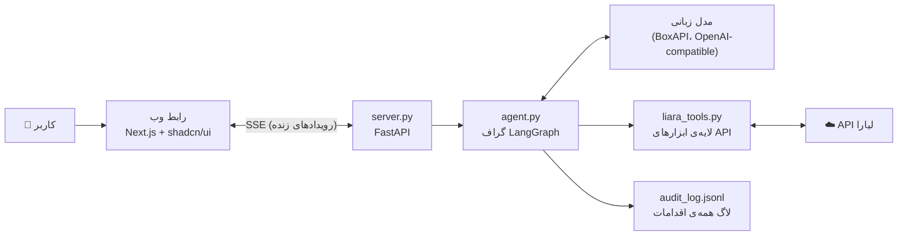
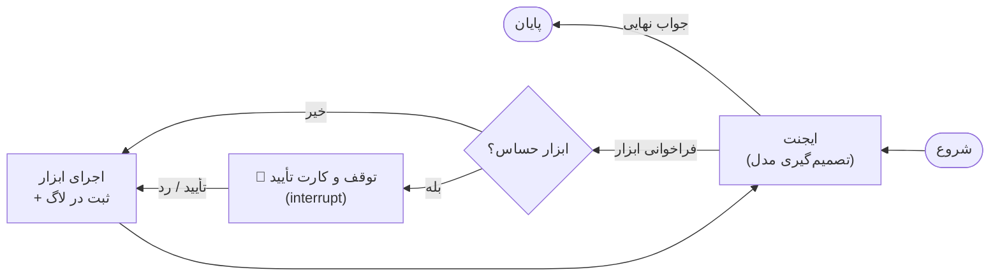

# دستیار هوشمند زیرساخت لیارا

یک ایجنت هوش مصنوعی که نقش **همکار فنی** صاحب سایت را روی لیارا بازی می‌کند. کاربر مشکل را به زبان ساده می‌گوید («سایتم کند شده»). دستیار با API لیارا شواهد جمع می‌کند، علت را پیدا می‌کند، راه رفع را پیشنهاد می‌دهد، **فقط با تأیید کاربر** اقدام می‌کند و بعد نتیجه را با عدد قبل و بعد بررسی می‌کند.

> این سند چهار بخش خواسته‌شده در چالش را پوشش می‌دهد: معماری، نحوه‌ی اتصال به API لیارا، محدودیت‌ها و نحوه‌ی تعامل کاربر.

---

## ۱. معماری



### گراف ایجنت (LangGraph)



| بخش | فایل | توضیح |
|---|---|---|
| لایه‌ی ابزار | `liara_tools.py` | هر عملیات API یک تابع با سطح ریسک `LOW` یا `HIGH`. پارس لاگ (صفحه‌به‌صفحه، یکی کردن stack trace، جدا کردن خطای فعلی از خطای قبل از آخرین راه‌اندازی) و متریک (درصد نسبت به سقف پلن). |
| مغز ایجنت | `agent.py` | گراف LangGraph با سه نود: `agent`، `approval`، `tools`. حافظه‌ی گفت‌وگو با `MemorySaver`. سقف ۱۲ دور برای هر درخواست. |
| API وب | `server.py` | FastAPI؛ هر قدم ایجنت را به‌صورت رویداد زنده (SSE) می‌فرستد. |
| رابط وب | `web/` | Next.js 14 + shadcn/ui، فارسی و راست‌چین، با الگوی Generative UI. |
| اجرای ترمینالی | `run_cli.py` | همان ایجنت در ترمینال. |
| سناریوهای دمو | `run_scenarios.py` | اجرای خودکار ۷ سناریو و ذخیره‌ی گفت‌وگوی هر کدام. |

### ابزارهای ایجنت

| ابزار | ریسک | کار |
|---|---|---|
| `get_app_status` | کم | وضعیت، پلن، scale و **فقط نام** متغیرهای محیطی |
| `get_logs` | کم | لاگ اخیر؛ `current_errors` با محل خطا در کد (فایل و خط) |
| `get_metrics` | کم | CPU و RAM و درصد نسبت به سقف پلن |
| `list_plans` | کم | پلن‌ها با RAM، CPU و قیمت ماهانه |
| `list_releases` | کم | آخرین دیپلوی‌ها و وضعیتشان |
| `list_domains` | کم | دامنه‌های متصل به برنامه |
| `check_url` | کم | تست HTTP آدرس سایت برای دیدن مشکل و بررسی نتیجه |
| `wait_seconds` | کم | صبر بعد از تغییر |
| `restart_app` | **زیاد** | ری‌استارت |
| `set_env` | **زیاد** | تنظیم متغیر محیطی (برنامه ری‌استارت می‌شود) |
| `resize_app` | **زیاد** | تغییر پلن (هزینه تغییر می‌کند) |
| `deploy_new_version` | **زیاد** | آپلود کد و ساختن نسخه‌ی جدید |

---

## ۲. نحوه‌ی اتصال به API لیارا

- **آدرس پایه:** `https://api.liara.ir`
- **احراز هویت:** هدر `Authorization: Bearer <LIARA_API_TOKEN>`
- **حساب تیمی:** پارامتر `teamID` در همه‌ی درخواست‌ها
- **منبع endpointها:** کد منبع CLI رسمی لیارا (`github.com/liara-cloud/cli`). همه با درخواست واقعی تست شده‌اند، به‌جز روشن/خاموش کردن (`scale`) و تغییر پلن.

| کار | متد و مسیر |
|---|---|
| جزئیات برنامه | `GET /v1/projects/{app}` |
| لاگ‌ها | `GET /v2/projects/{app}/logs?start=<unix>&direction=forward` (صفحه‌به‌صفحه) |
| متریک | `GET /v1/projects/{app}/metrics/summary` |
| پلن‌ها | `GET /v1/me` → `plans.projects` |
| دیپلوی‌ها | `GET /v1/projects/{app}/releases` و `GET /v1/releases/{id}` |
| دامنه‌ها | `GET /v1/domains?project={app}` |
| ری‌استارت | `POST /v1/projects/{app}/actions/restart` |
| روشن/خاموش | `POST /v1/projects/{app}/actions/scale` با `{"scale": 0 \| 1}` |
| متغیر محیطی | `POST /v1/projects/update-envs` با `{"project", "variables"}` |
| دیپلوی | `POST /v2/projects/{app}/sources` (فایل tar.gz) و بعد `POST /v2/projects/{app}/releases` |
| تغییر پلن | `POST /v1/projects/{app}/resize` با `{"planID"}` (از پروژه‌ی غیررسمی؛ تأییدنشده) |

مدل زبانی از **BoxAPI** با آدرس `https://ai.boxapi.ir/ai/v1` (سازگار با OpenAI) و مدل `openai/gpt-5-mini` استفاده می‌شود.

---

## ۳. نحوه‌ی تعامل کاربر با سیستم

**رابط وب** (چیدمان «چت پلاس»: چت در وسط، وضعیت زنده در کنار):

1. **پرسیدن به زبان ساده:** کاربر می‌نویسد یا یکی از پیشنهادهای آماده را می‌زند.
2. **دیدن هر قدم:** هر ابزار اول با «⏳ در حال انجام» و بعد با یک **کارت اختصاصی** نمایش داده می‌شود. مثلاً کارت متریک با نوار RAM و CPU، کارت لاگ با خطاهای فعلی و محل آن‌ها در کد، و جدول پلن‌ها با قیمت.
3. **کارت تأیید:** برای هر کار حساس، ایجنت متوقف می‌شود و کارتی با **دلیل**، **اثر** و برای تغییر پلن، **اختلاف هزینه‌ی ماهانه** نشان می‌دهد. کاربر «تأیید و اجرا» یا «رد» را می‌زند.
4. **کارت قبل و بعد:** بعد از اقدام، نتیجه با عدد نشان داده می‌شود (مثلاً RAM از ۳۹۹ به ۲۶ مگابایت، یا کد پاسخ از ۵۰۰ به ۲۰۰).
5. **پنل کناری:** وضعیت زنده‌ی برنامه، تاریخچه‌ی اقدامات (خودکار، تأییدشده، ردشده) و فهرست محدودیت‌های API.

**رفتار ایجنت:**
- اول شواهد جمع می‌کند و حدس نمی‌زند.
- علت‌ها را با دلیل رتبه‌بندی می‌کند.
- کارهای خواندنی را خودکار انجام می‌دهد.
- کار حساس را فقط با تأیید انجام می‌دهد.
- بعد از اقدام، نتیجه را دوباره بررسی می‌کند.
- اگر کاربر رد کند، می‌پذیرد و راه دیگری پیشنهاد می‌دهد.
- باگ کد را با فایل و خط توضیح می‌دهد و بعد از رفع، دیپلوی را پیشنهاد می‌دهد.

---

## ۴. محدودیت‌ها

- **دامنه:** ثبت دامنه و تنظیم DNS سرورها در ثبت‌کننده‌ی بیرونی (مثل ایرنیک) خارج از API لیاراست. اتصال دامنه‌ی جدید در کنسول لیارا انجام می‌شود. دستیار فقط وضعیت دامنه را می‌خواند و مراحل را راهنمایی می‌کند.
- **پرداخت:** افزایش اعتبار حساب از طریق API ممکن نیست.
- **متریک:** API فقط یک مقدار اخیر می‌دهد (بدون تاریخچه) و ممکن است چند دقیقه تأخیر داشته باشد. دستیار در این حالت به هشدارهای تازه‌ی لاگ اعتماد می‌کند.
- **تغییر پلن:** endpoint آن در CLI رسمی نیست و از پروژه‌ی غیررسمی برداشته شده است. اگر کار نکند، دستیار خطا را روشن به کاربر می‌گوید.
- **باگ کد:** دستیار کد را خودش تغییر نمی‌دهد. علت را با فایل و خط توضیح می‌دهد و بعد از رفع توسط توسعه‌دهنده، نسخه‌ی جدید را دیپلوی می‌کند.
- **تشخیص راه‌اندازی:** جدا کردن خطای قدیمی از خطای فعلی بر اساس خط‌های شروع برنامه در لاگ است (مثل `listening on`). برنامه‌هایی که چنین خطی چاپ نمی‌کنند، این جداسازی را ندارند.
- **حافظه‌ی گفت‌وگو** فقط در طول اجرای سرور نگه داشته می‌شود (`MemorySaver`).

---

## امنیت و حاکمیت ایجنت

- **دو سطح ریسک:** ابزارهای حساس بدون تأیید انسان اجرا نمی‌شوند (`interrupt` در LangGraph).
- **مشاهده‌پذیری:** هر اقدام با زمان، ابزار، ورودی، تأیید یا رد و نتیجه در `audit_log.jsonl` ثبت می‌شود.
- **اسرار:** مقدار متغیرهای محیطی به مدل زبانی فرستاده نمی‌شود و در لاگ با `***` پنهان می‌شود. توکن‌ها فقط در `.env` هستند و `.env` در `.gitignore` است.
- **کمترین دسترسی:** برای این پروژه توکن API با عمر کوتاه (مدت هکاتون) ساخته شده است.
- **جلوگیری از حلقه:** حداکثر ۱۲ دور فکر کردن برای هر درخواست. ابزار تست آدرس اجازه‌ی صدا زدن مسیرهای مضر (`/leak` و `/cpu`) را ندارد.

---

## نصب و اجرا

**پیش‌نیازها:** Python 3.11 یا بالاتر، Node.js 18 یا بالاتر، توکن API لیارا، کلید BoxAPI.

```bash
# 1. Python environment
python3 -m venv ~/.venvs/liara && source ~/.venvs/liara/bin/activate
pip install -r requirements.txt

# 2. Settings
cp .env.example .env      # then put your real values in .env

# 3. Check the Liara connection (read-only)
python3 check_tools.py

# 4. Web interface: API on :8000 and web on :3000
./start_web.sh            # then open http://localhost:3000
```

**راه‌های دیگر:**
- اجرا در ترمینال: `python3 run_cli.py`
- اجرای همه‌ی سناریوهای دمو: `python3 run_scenarios.py` (و `--only S7` برای تغییر پلن). خروجی در `scenario_outputs/` ذخیره می‌شود.

### ضبط ویدئوی دمو

`demo/record_demo.py` ویدئوی دمو را از **محصول واقعی** ضبط می‌کند. هر سناریو یک کلیپ جداست، زیرنویس فارسی دارد و آماده‌سازی‌ها ضبط نمی‌شوند. خروجی `demo/output/demo.mp4` است. متن صداگذاری در `demo/NARRATION.md` است.

### برنامه‌ی آزمایشی (`target-app/`)

یک برنامه‌ی Node.js کوچک که روی لیارا دیپلوی می‌شود و مشکل‌ها را عمداً می‌سازد:

| مسیر | مشکل |
|---|---|
| `/error` | باگ کد (TypeError در خط ۲۷) و خطای ۵۰۰ |
| `/greet` | نبود متغیر محیطی `GREETING` و خطای ۵۰۰ |
| `/leak` | نشت حافظه (هر درخواست حدود ۲۰ مگابایت) |
| `/cpu` | مصرف بالای CPU |

---

## ساختار فایل‌ها

```
liara-assistant/
├── liara_tools.py      # Liara API tool layer (risk levels, log and metric parsing)
├── agent.py            # LangGraph agent: approval gate, audit log, system prompt
├── server.py           # FastAPI + SSE for the web interface
├── run_cli.py          # Terminal chat
├── run_scenarios.py    # Automatic demo scenarios with transcripts
├── check_tools.py      # Read-only connection test
├── start_web.sh        # Start API + web
├── web/                # Next.js + shadcn/ui (Persian, RTL, generative UI cards)
└── target-app/         # Demo app with problems on purpose
```
